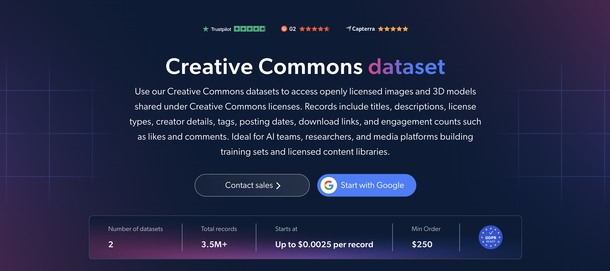

# Creative-Commons-dataset-samples

<h2>A sample dataset of 1000 Creative Commons images</h2>

<a href="https://brightdata.com/products/datasets/creative-commons">
   
</a>

A Creative Commons dataset sample of 1000 openly licensed images. Dataset was extracted using the <b>Bright Data API</b>.

<h2>Some of the data points that are included in the dataset:</h2>

* ```url```: URL of the image's source page
* ```title```: Title of the image
* ```description```: Description of the image
* ```image_url```: Direct URL of the image
* ```creators```: Creators of the image
* ```license```: Creative Commons license type of the image
* ```keyword```: Keyword used to find the image
* ```type```: Type of the image
* ```domain```: Source domain of the image
* ```date_taken```: Date the image was taken or uploaded
* ```dimensions```: Dimensions of the image

This is a sample subset which is derived from the "Creative Commons Images (public data)"
dataset which includes more than <b>3,500,000 images</b>.

Available dataset file formats: <b>JSON, NDJSON, JSON Lines, CSV, XLSX, or Parquet. Optionally, files can be compressed to .gz</b>.

Dataset delivery type options: <b>Email, API download, Webhook, Amazon S3, Google Cloud storage, Google Cloud PubSub, Microsoft Azure, Snowflake, SFTP</b>.

Update frequency: <b>Once, Daily, Weekly, Monthly, Quarterly, Biannual, or Custom basis</b>.

Data enrichment available as an addition to the data points extracted: <b>Based on request.</b>

<b>[Get the full Creative Commons dataset](https://brightdata.com/products/datasets/creative-commons)</b>.

<a href="https://brightdata.com/products/datasets/creative-commons">
</a>

<h2>What are the Creative Commons datasets use cases?</h2>

<h3>1. AI training data</h3>
AI teams use Creative Commons datasets to build image training sets from openly licensed content. Filtering by license type, keyword and dimensions keeps usage terms clear and makes it easy to assemble datasets for image recognition, computer vision and multimodal models.

<h3>2. License compliance</h3>
Companies check the license and creators behind each image to attribute correctly and reuse only what each license allows. This reduces legal risk when using open content in products, publications and marketing materials.

<h3>3. Licensed content libraries</h3>
Media platforms, publishers and educators use image titles, descriptions, keywords and source domains to build searchable libraries of openly licensed images. This gives creative teams a large pool of reusable visuals for content creation, research and education.

<h2>Free access to web scraping tools and datasets for academic researchers and NGOs</h2>

The Bright Initiative offers access to Bright Data's <b>[Web Scraper APIs](https://brightdata.com/products/web-scraper)</b> and <b>[ready-to-use datasets](https://brightdata.com/products/datasets)</b> to leading academic faculties and researchers, NGOs and NPOs promoting various environmental and social causes. You can submit an application <b>[here](https://brightinitiative.com)</b>.
